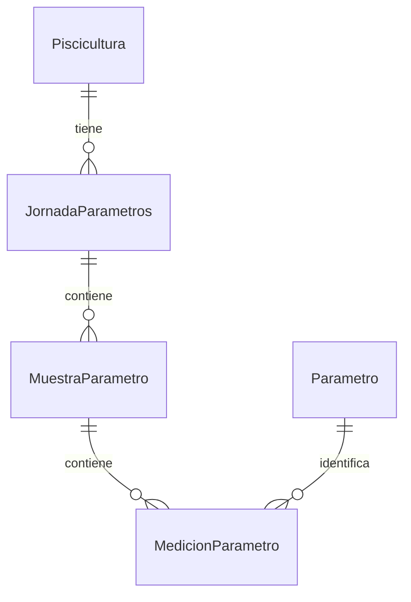
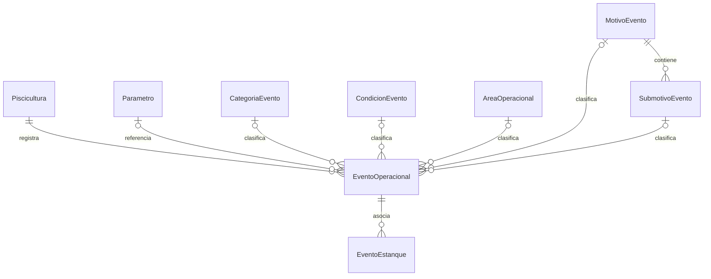
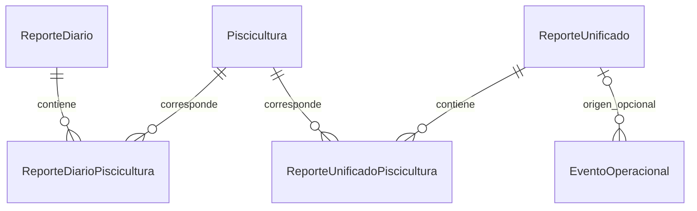

# Modelo de datos relevante

**Fuente técnica:** [esquema Prisma](../../prisma/schema.prisma) y [migraciones](../../prisma/migrations/). Los diagramas muestran relaciones existentes, no una propuesta de nuevos modelos. `||` indica el lado único, `o|` una referencia opcional y `o{` una colección que puede estar vacía. La restricción funcional de Santa Juana en la toma rutinaria aún no está impuesta por el esquema.

## Parámetros

`JornadaParametros` es única por piscicultura y fecha. `MuestraParametro` es única por jornada, sistema y hora. `MedicionParametro` es única por muestra, parámetro y punto; su `valor` decimal es obligatorio. Una ausencia no se guarda como cero para el cálculo de promedios. La jornada dispone de `configuracion` JSON opcional, sin mediciones.

## Eventos y catálogos

Las referencias de `EventoOperacional` a parámetros y catálogos son opcionales. `EventoEstanque` usa clave compuesta `eventoId` y `estanque`. Las dos referencias a motivo y submotivo son independientes: todavía no garantizan su correspondencia; véase [Eventos](../modulos/eventos.md).

## Reportes

`ReporteDiarioPiscicultura` y `ReporteUnificadoPiscicultura` son únicos por reporte y piscicultura. `ReporteDiario` es único por fecha y turno; `ReporteUnificado` es único por fecha de emisión. `EventoOperacional.reporteOrigenId` es opcional y apunta a `ReporteUnificado`. **No existe una relación Prisma entre `EventoOperacional` y `ReporteDiario`**, ni una tabla que duplique eventos por cada reporte que los muestre. La aparición de un evento en una ventana es una consulta temporal, no una nueva relación persistida. Los requisitos funcionales de ambos reportes [siguen en revisión](../modulos/reportes.md).
